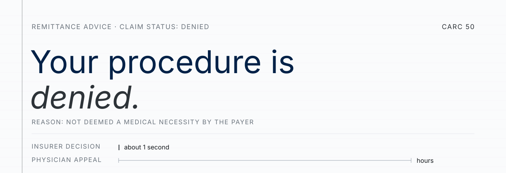
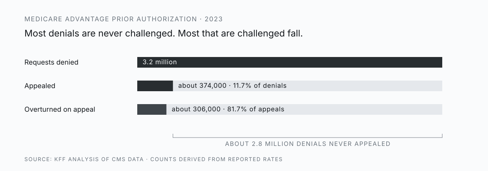
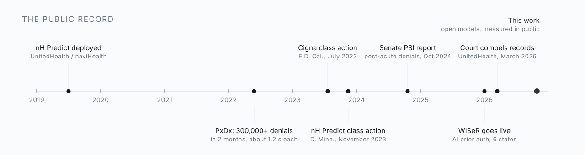
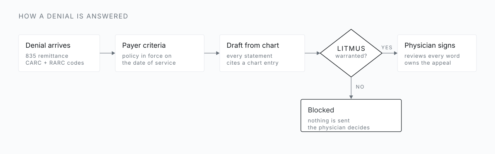

<picture>
  <source media="(prefers-color-scheme: dark)" srcset="assets/header-dark.svg">
  
</picture>

<p align="center">
  <a href="#abstract">Abstract</a> ·
  <a href="#1-introduction">Introduction</a> ·
  <a href="#2-methods">Methods</a> ·
  <a href="#3-results">Results</a> ·
  <a href="#4-discussion">Discussion</a> ·
  <a href="https://demo.hemeehr.com">Live replay</a> ·
  <a href="#build-log">Build log</a> ·
  <a href="#from-the-inside">Contribute</a>
</p>

<p align="center">
  <a href="https://doi.org/10.5281/zenodo.21227402"></a>
  <a href="https://doi.org/10.5281/zenodo.21227855"></a>
  <a href="https://doi.org/10.5281/zenodo.23794798"></a>
  
  
</p>

<br>

> An insurer can now issue a claim denial in about a second. Answering it takes a physician hours. In between, a patient waits to learn whether the operation their surgeon recommended will be approved or refused.
>
> — James H. Rosing, MD, FACS · Board-certified in general and plastic surgery · Newport Beach, California

This repository is the public record of one physician's attempt to change that balance: the evidence, the standard I believe every medical AI should meet, and the work of meeting it, measured in the open.

**What this is, and is not.** The software here drafts the administrative response to a payer's denial, from the physician's own chart, against the payer's own written criteria, for the physician to read and sign. It gives no advice to patients, recommends no treatment, and sends nothing on its own. Every sentence it drafts is checked against the record by a deterministic gate before a physician sees it, and the physician's signature is the only thing that makes it an appeal.

<br>

<p align="center"><sub><b>Fail-closed verification of model-drafted claim-denial appeals against the clinical record: a 50-case synthetic benchmark of three Meta models.</b><br>James H. Rosing, MD, FACS · Newport Beach, California · Meta Global AI Developer Hackathon, October 26 to November 4, 2026<br>Keywords: claim denial · medical necessity appeal · prior authorization · large language models · fabrication · fail-closed verification · Medicare Advantage</sub></p>

## Abstract

The insurer has given the denial to a machine, and the machine answers in seconds. The physician has been given nothing, and must meet in hours what was done in an instant, so most denials are never met at all. Yet the reply owed is no small thing. It is a writ in the oldest sense of the word: an instrument set down in writing, issued under a signature, and binding its author to every word it contains. A machine may draft such an instrument. But a draft that asserts one thing the record does not hold, over a physician's name, is worse than none. I asked, therefore, whether Meta's models, one of them open weights, could prepare that instrument from the chart with every sentence held to the record by a deterministic check, decline when the record could not support one, and do so at a cost and speed a practice could use; and whether the same check, pointed the other way, would hold the insurer's own determination to the same record. Fifty synthetic claim denials across eighteen high-dollar services, thirty answerable from the chart and twenty not, $940,000 of billed care in all, were generated with a grading key. Three Meta models drafted responses with the chart in the prompt, by tool calls, and with a live query of a coverage index; a deterministic gate reimplemented from the LITMUS papers verified every quote and every number, date, code, and side against the cited entry, and 9,475 injected fabrications measured its sensitivity. Across nine kept runs, agreement with the key was 45 to 50 of 50 with no fabricated quote in any sentence. muse-spark-1.3 defended the full $568,500 billed across the thirty warranted cases in each of its three runs, at $0.63 to $0.96 for a run of fifty; the gate caught 5,781 of 5,781 hard corruptions and none of 2,386 negation or pronoun changes, at 4 to 16 seconds and $0.007 to $0.054 a case; one draft passed on a case the key labels unsupported. Pointed at the plan's own determination over the same charts, the gate refuted the one fabricated quote and passed a denial whose every sentence was in the record and whose reading of the criterion was wrong: one chart, two verified conclusions, no side taken. A physician can now answer a denial at the speed and cost at which it was issued, with every statement held to the record. The gate verifies that a statement is in the record, not that the record satisfies the criterion; the machine prepares the instrument and cannot issue it, and the physician's signature is what makes the draft a writ.

<br>

## 1. Introduction

### 1.1 The problem

| Requests denied | Denials appealed | Appeals overturned |
| :---: | :---: | :---: |
| **3.2 million** | **about 374,000** | **about 306,000** |
| 6.4% of 49.8 million requests | 11.7% of denials | 81.7% of appeals |

<sub>Medicare Advantage prior authorization, 2023.[^kff] Appealed and overturned counts are derived from the reported rates.</sub>

<picture>
  <source media="(prefers-color-scheme: dark)" srcset="assets/attrition-dark.svg">
  
</picture>

When denials are challenged, most fall. Most are never challenged, because the cost of answering lands on the people with the least time. Physicians report 13 hours a week spent on prior authorization, and 79% say patients have abandoned treatment while waiting.[^ama]

The rules are not uniform. Each payer writes its own, and in 2022 the HHS Inspector General found Medicare Advantage plans applying clinical criteria that Medicare itself does not use, denying requests that met Medicare coverage rules.[^oig]

The surgeon whose judgment is overridden spent four years in medical school and five or more in residency and specialty training, and carries the license, the liability, and the duty to see the patient through. The decision to refuse carries none of that weight.

I do not think most of the people who build these systems set out to harm patients. But a system rewarded for saying no, and rarely asked to show its reasons, will say no more often than it should.

<br>

### 1.2 The public record

<picture>
  <source media="(prefers-color-scheme: dark)" srcset="assets/timeline-dark.svg">
  
</picture>

<details>
<summary><b>Read the five cases</b></summary>
<br>

| Who | Tool | What is alleged or reported | Status |
| --- | --- | --- | --- |
| UnitedHealth (naviHealth) | nH Predict[^unh] | Predicts post-acute length of stay for Medicare Advantage patients; plaintiffs allege about 9 in 10 denials were reversed on appeal | Class action in discovery, D. Minn.; March 2026 order compels records back to 2017 |
| UnitedHealthcare | Post-acute review[^psi] | Post-acute denial rate rose from 8.7% (2019) to 22.7% (2022) | Senate investigation report, October 2024 |
| CVS Health | Post-Acute Analytics[^psi] | AI project to reduce skilled nursing spending; savings target raised to $77.3M over 3 years | Senate investigation report, October 2024 |
| Cigna | PxDx[^cigna] | 300,000+ claims denied in 2 months of 2022, averaging 1.2 s each | Class action, E.D. Cal., filed July 2023 |
| Medicare Advantage insurers, UnitedHealth foremost | Insurer-initiated diagnoses[^wsj] | Wall Street Journal analysis: diagnoses added by insurers rather than by a treating doctor drew about $50 billion from Medicare over 2018 to 2021, many of them recorded by nurses the insurers sent into members' homes; about 66,000 patients were coded with diabetic cataracts after cataract surgery, which removes the lens, and UnitedHealth members were about 15 times as likely as traditional Medicare patients to carry that diagnosis | Series, July to August 2024. In July 2025 the company disclosed that it is cooperating with Department of Justice criminal and civil investigations of its Medicare billing[^doj] |
| CMS | WISeR[^wiser] | AI-supported prior authorization in traditional Medicare across 6 states, including skin substitutes, nerve stimulators, knee arthroscopy for osteoarthritis, and cervical fusions[^cms] | Live since January 2026; repeal resolution pending |

The insurers dispute these characterizations. UnitedHealth says nH Predict only guides care planning, called the Journal's analysis of its diagnoses "inaccurate and biased," and says it has full confidence in its practices; Cigna says PxDx is not AI.

</details>

<br>

### 1.3 A standard, not a product

<table><tr><td>
<br>
<p align="center"><b>No machine should make a claim about a patient's care that it cannot support.</b></p>
<p align="center">It must cite its source or show its derivation.<br>If it cannot, it stops, and the physician decides.</p>
<br>
</td></tr></table>

I wrote that standard down as **LITMUS** and published it openly under CC BY 4.0, so anyone can use it, test it, or argue with it. It applies to an insurer's algorithm as much as to mine.

#### [Litmus: The Admissible Set](https://doi.org/10.5281/zenodo.21227402)
<sub>Position paper · Rosing, J. H. · Zenodo, July 6, 2026 · doi:10.5281/zenodo.21227402</sub>

Generative artificial intelligence is entering clinical work ahead of any agreed method for making it safe. This paper argues that an autonomous system can be trusted only in proportion to the strength of the external check that verifies it, and that medicine has exactly one valid check: the certified specialist physician. That check has a definite shape. It returns membership in a small admissible set of treatments a qualified body would accept, a structure independently confirmed by a century of malpractice doctrine. Because the basis for membership is partly explicit and partly tacit, the machine may act alone only where consensus is explicit and settled, and must defer to the physician everywhere else. The paper sets out this method, litmus-gated reach, and the buildable system it implies.

#### [Litmus: The Admissible Set (System Architecture)](https://doi.org/10.5281/zenodo.21227855)
<sub>Architecture companion · Rosing, J. H. · Zenodo, July 6, 2026 · doi:10.5281/zenodo.21227855</sub>

This companion document specifies the system architecture implied by Litmus: The Admissible Set. The design is one substrate applied to many workflows: a model-pluggable agent runtime, an extensible registry of standardized tools, and a fail-closed verification spine whose criteria are curated per specialty. The machine acts alone where physician consensus is explicit, routes an evidence-bounded case to the certified specialist where it is not, and records every claim, gate decision, and verdict in a provenance layer. Feedback from physician verdicts, payer adjudication, and clinical outcomes widens what can be verified over time. The document details the layers, the runtime flow, an end-to-end medical coding and appeals workflow, the build sequence from existing components, and how the architecture scales across specialties and absorbs advances in model capability.

<details>
<summary>Cite</summary>

```bibtex
@misc{rosing2026litmus,
  author    = {Rosing, James H.},
  title     = {Litmus: The Admissible Set},
  year      = {2026},
  publisher = {Zenodo},
  doi       = {10.5281/zenodo.21227402}
}
@misc{rosing2026litmusarch,
  author    = {Rosing, James H.},
  title     = {Litmus: The Admissible Set (System Architecture)},
  year      = {2026},
  publisher = {Zenodo},
  doi       = {10.5281/zenodo.21227855}
}
```

</details>

<br>

### 1.4 What is not known

Large language models can write a medical-necessity letter that reads well. Whether one can write such a letter without stating anything the chart does not contain, under a check that can prove it did not, has not been measured on a set anyone can rerun. Nor has the second half of the task been measured: whether the model declines when the record cannot answer the denial, including the administrative denials for which a medical-necessity appeal is the wrong instrument. The LITMUS papers predict the shape of the answer, a deterministic check that verifies presence in the record and not sufficiency against the criterion, but they contain no measurement.

### 1.5 Objective and hypothesis

The objective was to measure, on a fixed synthetic set with a grading key, whether three Meta models, one of them open weights, can draft the physician's response to a claim denial from the chart with every sentence verified against the record, decline when the record cannot answer, and do so at a cost and latency a practice could use. The hypothesis: a deterministic referential gate reduces fabricated statements in model-drafted appeals to zero on this set, at the cost of some true derivations blocked, without reducing agreement with the key below ninety percent. The secondary question was whether a model given the chart as an index and two tools, rather than whole, reads what a reviewer would read.

<br>

## 2. Methods

### 2.1 Study design and setting

A bench study on synthetic data, run during the Meta Global AI Developer Hackathon[^hack] (October 26 to November 4, 2026). No human subjects, no patient data, no institutional review. Everything in [`/build`](build/) was written during the event; the ledger [NEW-WORK.md](NEW-WORK.md) has a row for every commit, and the [build log](#build-log) is regenerated from the git history and the result files after every push.

The line between what was fixed before the reported runs and what changed after them is drawn by the git history, not by memory.

| Fixed before the kept runs began (October 27, 01:17 PT, commits `4fba43c` to `d9a2ed0`) | Changed after, each with a ledger row |
| --- | --- |
| The fifty cases and their grading keys. Four keys were corrected during development runs between 00:40 and 01:17 PT, each defect found by a model reading the chart (section 4.4); no case file changed after the kept runs began. | The agentic mode and its two chart tools (October 27, 20:22 PT) and the live policy query (October 27, 23:44 PT). |
| The gate (v1) and the appeal contract: one citation per sentence, a verbatim quote, every hard token sourced. Fact sourcing was widened from the quoted span to the whole cited entry after a development run (00:50 PT). | Gate v1.1 to v1.4: compound number words read as one number, hundreds included, a needs-citation label naming the entry that holds a missing token, and a side treated as a hard token wherever it names one. Every kept run was re-gated under each version with the change recorded in the file; re-gating to v1.3 changed seven sentence labels and no verdict, to v1.4 none. |
| The primary measure, agreement with the key, and the outcome categories. | The advisor (October 28), the mutation harness (October 28), the repeat runs (October 28 to 29), the payer-side runs (October 29, section 2.7), the viewer, and this document. |
| Three models, effort low, eight cases in flight. | The repair turn and the stated reason (October 30, 23:25 PT, section 2.9, Table 5); the effort sweep (October 30, 23:33 PT, section 2.10, Table 6); the letters and their intake (October 30, 23:45 PT, section 2.11, Table 7); the compare tab and the live run (October 30, section 2.8); the dictation pipeline (October 31, section 2.12). Every run from these is post hoc and sits in its own directory; Table 1 is unchanged. |

### 2.2 The system under test

<picture>
  <source media="(prefers-color-scheme: dark)" srcset="assets/flow-dark.svg">
  
</picture>

A denial arrives with its reason code and the payer's remark. The model is given the payer's written criteria, the denial, the case facts, and the chart, and asked for one of two things: a decision that the record does not support an appeal, with the reason, or a draft in which every sentence carries one citation to one chart entry and a verbatim quote from it. The gate then checks every sentence. If the record does not support an appeal, the software says so instead of arguing anyway. Nothing is sent without a physician's signature. The viewer renders a passing draft as that instrument ([`build/viewer/src/writ.ts`](build/viewer/src/writ.ts)): the payer's reason quoted at the head, each sentence footnoted to the entry, date, and verbatim quote the gate verified it against, the gate version and the input hash at the foot, and a blank signature line under a band that reads draft, unsigned, not sent (Figure 8). It can be printed or saved as text; the page sends nothing.

### 2.3 The fifty cases

**What kind of denial.** Every case is a claim denied after the service was given: the payer's remittance, carrying a claim adjustment reason code (CARC) and the payer's remark, for a procedure, admission, drug, or continued stay already delivered. None is a prior-authorization request refused before care. The statistics under The problem are prior-authorization figures because that is where the public record is richest; the response to either kind of denial is the same document, the physician's record read against the payer's written criteria, and the set should be read as a test of that document, not of the prior-authorization process. Thirty-four cases carry CARC 50, not medically necessary. Three carry CARC 197, no authorization on file: in two the plan allows a retrospective medical-necessity review and the chart answers it, and in one the plan refuses that review, so a medical-necessity appeal is the wrong instrument and the right answer is to decline. The rest are experimental or investigational (56), non-covered (96, 167), diagnosis or modifier inconsistent with the procedure (11, 4), frequency (151), benefit maximum (119), and timely filing (29).

**How they were made.** The set is generated, not hand-written. [`build/src/synthetic/generate.ts`](build/src/synthetic/generate.ts) builds all fifty deterministically from a fixed seed (20261027) using 18 service templates in [`build/src/synthetic/templates/`](build/src/synthetic/templates/), one per service in the table in [`build/synthetic/README.md`](build/synthetic/README.md), and a test checks that the committed files match the generator, so anyone can regenerate them with `npm run synthetic` and get the same bytes. A fixed plan allocates 30 warranted cases, where the chart documents every criterion, and 20 that are not, in four kinds: 6 where the chart never addresses a criterion, 7 where it raises the criterion but falls short, 4 administrative denials no chart can answer, and 3 plan exclusions (one case, case-023, was relabeled from the first kind to the second on October 30 after the archived version, with the reason under Limitations; its text is unchanged). Each template writes the chart in dictation voice, the way a clinician speaks a note, not the way a payer checklist reads, and the generator adds the routine traffic a real chart has, a referral letter, a blood-pressure check, a pharmacy call, so that about two thirds of the 19 to 35 entries (mean 25.6) are unrelated and a citation has to land on the right one. The six payers are fictional, alternating a standard and a strict criteria profile, and the criteria attributed to them were written for this benchmark from publicly described policy patterns; they are not any insurer's policy. A patient is an alias, an age, and a sex. Each case carries its grading key: whether an appeal is warranted, which criteria the chart meets, which entries support each, which entries are unrelated, and a one-line rationale. The key was written by the same person who wrote the templates, and four of its labels were wrong until the models found them (section 4.4).

Read as an experiment, the thirty warranted cases are positive controls, the twenty others are negative controls of four kinds, the unrelated entries in every chart are the noise floor for citation precision, and the injected fabrications in section 2.7 are spike-ins.

### 2.4 The gate

The gate is [`build/src/litmus.ts`](build/src/litmus.ts), reimplemented during the event from the published papers and not copied from any prior system. It is deterministic and sits outside the model. For each sentence it resolves the citation to one chart entry; requires the quote to appear verbatim in that entry, with whitespace, case, and quote glyphs normalized and nothing else; and requires every hard token in the sentence, each number, date, code, and side, to appear in the cited entry, the payer criteria, the denial, or the stated case facts. A sentence that fails is refuted with the token named, or, from v1.3, returned as needs-citation when every missing token lives in some other entry of the same chart. A check that throws is an error, never a pass. A draft passes only when every sentence verifies and every criterion the draft claims has verified evidence; otherwise it is blocked. The gate has no resemblance threshold and no keyword list. Its version is stamped into every verdict, and because it is a pure function of its inputs, any stored draft can be re-gated under a later version and the change recorded (`npm run regate`).

The same gate runs in the viewer. Once a replay has reached its verdict, any sentence can be edited in the page, its words, its quote, or its citation, and re-checked by the gate bundled into the browser from the same module and the same admissible sources ([`build/viewer/src/gatecheck.ts`](build/viewer/src/gatecheck.ts), [`build/src/sources.ts`](build/src/sources.ts)); the result is stamped with its reason, nothing is saved, and the stored verdict does not change. It is the spike-in of section 2.7 as a control a reader can turn by hand (Figure 7). To make the module run in a browser, its provenance hash is a plain SHA-256 in TypeScript ([`build/src/hash.ts`](build/src/hash.ts)); a test checks that it reproduces every input hash stored in the result files.

### 2.5 Models, modes, and the live policy query

Three models were tested: muse-spark-1.3 and muse-wonder-1.0 through the Meta Model API, and Muse Spark Open, the open-weights model, hosted on Baseten, all at effort low with eight cases in flight (three for Baseten after a run at eight lost cases to rate limiting). Each model ran in three modes. In the first the whole chart is in the prompt. In the second, the agentic mode, the model receives an index, one line per entry with the id, date, kind, and opening words, and two tools, `list_entries` and `read_entry`, and reads what it decides it needs; every tool call is kept in a trace. The third adds a tool, `policy_status`, which queries CHART, the author's pre-existing coverage index of United States payer policy, for when the named authority's coverage material last changed and was last checked. It returns no policy text, so the criteria in the request remain the criteria, and its answer is labeled as a live query against a prior-work data source wherever it appears. The viewer at [demo.hemeehr.com](https://demo.hemeehr.com) replays any case from any kept run one tool call at a time (source in [`build/viewer/`](build/viewer/)).

### 2.6 The advisor

After the gate, a second model (muse-wonder-1.0) is shown each criterion with the quotes the draft cited for it and asked one question: do these quotes, read literally, satisfy the criterion? It answers supports, partial, or silent, with one sentence why. The answer is stored with the model's name and shown beside the criterion in the viewer. It never feeds the gate and never changes an outcome; it is an opinion with a name on it, for the physician to weigh ([`build/scripts/advise.ts`](build/scripts/advise.ts)).

### 2.7 Outcome measures and analysis

The primary measure is agreement with the grading key: a case counts as agreed when the model drafts an appeal for a case the key labels warranted and the gate verifies every sentence, or when the model declines a case the key labels unsupported. The other outcomes are blocked (the model drafted and the gate stopped it), false pass (the gate passed a draft on a case the key labels unsupported), and failed (no valid answer). Secondary measures: fabricated quotes (a quote not found verbatim in the cited entry, in a sentence or in an evidence item), sentences verified, citation precision (the share of cited entries the key names as evidence), entries read per case and the share of the key's evidence entries opened (agentic modes), median latency, and cost per case from the provider's token prices.

The gate's sensitivity cannot be read off runs in which no model fabricated anything, so it was measured by spike-in: each sentence the kept runs verified was corrupted one way at a time and re-gated ([`build/scripts/mutate.ts`](build/scripts/mutate.ts)). Corruptions were classed as hard (a number replaced by a value absent from every admissible source, the citation moved to an entry lacking the quote, a word dropped from the quote, a date shifted, a side swapped), collision (a wrong number or side that happens to appear in an admissible source), and soft (a negation flipped, a pronoun swapped). Sensitivity is the share caught; where none was missed, the 95 percent upper bound on the miss rate is given by the rule of three. Agreement counts carry 95 percent Wilson intervals. Run-to-run variance was measured by repeating each live-query configuration with the same cases and settings. Fifty cases is a small set: one case is two percentage points.

A post hoc run put the gate on the other side of the exchange (`npm run harness -- --side payer`, added October 29 after the kept runs). The same three models, over the same fifty charts and criteria, were asked for the plan's written claim determination instead of the physician's appeal, under the same contract and the same gate, with the key inverted: a denial is warranted exactly where the record fails a criterion ([`build/src/harness.ts`](build/src/harness.ts), `INSTRUCTIONS_PAYER`). The outcomes mirror the primary ones: declined to deny where the record supports the service, a verified determination where it does not, a determination written against a record that supports the service (the symmetric false pass), blocked, and failed. These runs are kept apart in `build/results/payer/` and do not enter Tables 1 and 2 or the viewer's scoreboard.

### 2.8 Reproducibility

`npm test` runs the suite (236 tests). `npm run synthetic` regenerates the fifty cases byte for byte. `npm run harness` runs a model over the set and writes a result file whose header records the model, mode, gate version, and any later re-gate. `npm run mutate` reruns the spike-in. `npm run log` regenerates the build log and the tables in section 3 from the result files; nothing in those tables is typed by hand.

The gate also ships on its own, as a command-line tool and an MCP server ([`build/litmus-gate/`](build/litmus-gate/)): `npm run gate -- check draft.json case.json` returns the verdict with exit code 0, 1, or 2 for pass, blocked, or declined, and `litmus-gate mcp` serves `litmus_verify_draft`, `litmus_check_sentence`, and `litmus_contract` over stdio to any agent host, so a drafting agent can be held to the record before its draft is shown to anyone. It is published on npm as [`litmus-gate`](https://www.npmjs.com/package/litmus-gate), so `npx -y litmus-gate mcp` needs no checkout. Both wrap the module the harness and the viewer call, and a test checks that they reproduce every stored verdict and hash of a kept run.

A live run can be watched from a terminal. `npm run live -- --case case-001` runs the primary configuration (muse-spark-1.3, agentic, live CHART) on one case and streams one line per tool call as it happens, with the time since the start, the tool, its input, the entry id, whether it resolved, and the reason the model gave; it ends with the verdict, the gate version, the gate's input hash, and a hash of the record alone. The input hash covers the draft, so two live drafts of one case never share it; the record hash covers the chart, the criteria, the denial, and the case facts, and the viewer shows the same value in the case header, so a reader can tell that the terminal and the replay are on the same record. No results file is written unless `--out-dir` is given. The viewer's Compare tab (the `c` key) lays the three models' kept live-CHART results for one case side by side from the stored files: the entries each opened in order, its sentences with their stamps, the verdict, the cost, and the latency. The viewer is checked in headless Chromium, not by reading (`npm run viewer:check`).

### 2.9 The repair turn and the stated reason (post hoc)

Both additions were made on October 30, after the kept runs, and every run that uses them is post hoc.

**The repair turn.** The harness took a `--repair N` option (default 0; every kept run was at 0). When the gate blocks a warranted draft and a repair remains, the harness sends the model one more user turn in the same exchange: the gate's record, verbatim, one line per finding, each unverified sentence with its index, its status, its reason, and, for a needs-citation, the entries the gate names as holding the token, then the draft-level reasons (an empty warranted draft, a criterion with no verified evidence). The model is asked for the complete revised draft under the same JSON schema, keeps its tools and its earlier reads in the agentic mode, and is told that declining is an answer. The revised draft is re-gated under the same gate. A declined draft is never offered a repair: the model's decision to decline stands, and the harness enforces it. The result file keeps the gate record before any repair and the outcome scored on it (`firstGate`, `firstOutcome`) beside the final outcome, and every repair turn with the reasons sent, the revised draft, its gate record, its tokens, and its latency (`repairs[]`). The summary reports separately how many repairs turned a blocked draft on a case the key labels unsupported into a pass, which would be the repair eroding the decline (Table 5, false passes created). The three live-CHART configurations were run again with `--repair 1` into `build/results/repair/`; Table 1 is unchanged. In the viewer a repaired case shows the first draft stamped and blocked, the repair turn with the reasons sent, the entries the model then read, and each sentence re-stamped from its first status to its final one with the gate's reason between.

**The stated reason.** The Meta Model API returns the model's reasoning only as `redacted_thinking` blocks (`npm run test-call` on October 30 reported content block types `redacted_thinking, text`), so there is no thought text to show. Instead, the two tools that open something, `read_entry` and `policy_status`, took a required `why` field: one sentence on what the model expects the entry to bear on and why it is opening it now. The executor ignores the field; the trace records it on the tool-call event, cut at 400 characters, and the viewer types it out under the chart column as the entry lights. Nothing is faked: a trace without a `why` shows none. The repair runs are the first to carry it.

### 2.10 The effort sweep (post hoc)

The kept runs used effort low, fixed before they began (section 2.1). On October 30, after the kept runs, muse-spark-1.3 and Muse Spark Open were run again in the live-CHART configuration at effort medium and at effort high: the same 50 cases, the same tools, the same 12,288-token output cap, the same gate, into `build/results/effort/` (`npm run harness -- --agentic --chart --effort medium`). Effort is the API's `output_config.effort`, set explicitly on every call; on the Meta Model API the reasoning it buys is reported as `thinking_tokens` and billed as output, and on the Baseten endpoint it is not reported. muse-wonder-1.0 was not swept: its kept run agreed on 50 of 50 and it is the costliest of the three. The `why` field of section 2.9 was in force. Table 6 reports each run beside the model's kept effort-low run.

### 2.11 The denial as a letter, and its intake (post hoc)

A practice does not receive a case file; it receives a remittance. On October 30 each of the fifty denials was rendered as a one-page remittance letter image, 1275 by 1650 pixels, deterministic from the case file ([`build/src/synthetic/letters.ts`](build/src/synthetic/letters.ts), `npm run letters`): a fictional payer letterhead, the patient alias with age and sex, one claim line with the code and its code system, the dates of service, the billed amount (the case's stakes figure) and nothing allowed, the CARC code and its text, the RARC where there is one, the payer's remark, and an appeal-rights paragraph with that payer's own appeal window. No member, subscriber, or claim identifier appears, because the set issues none, and the page says so. The HTML is rendered by Playwright's Chromium through `playwright-core`, a plain JavaScript package; the fifty images are committed under [`build/synthetic/letters/`](build/synthetic/letters/) with a manifest of hashes, and a test regenerates the HTML of every letter and two of the images and compares the bytes.

Each image was then sent to muse-spark-1.3 as a base64 image block with a JSON schema for eight fields, the CARC, the remark, the first and last dates of service, the code, the code system, the billed amount, and the payer's name ([`build/src/intake.ts`](build/src/intake.ts), `npm run intake`, effort low), and each field read was scored against the case file: exact after trimming for codes and dates, exact after whitespace and quote normalization for the remark and the payer's name, a number for the amount, empty for no service end. This is document intake of an administrative letter and nothing clinical: no chart entry is sent, no clinical judgment is asked for, and the model is told to transcribe what is printed and to leave a field empty rather than guess. Table 7 reports the result. In a production path the intake would fill the denial fields the appeal step needs; here it is measured on its own.

### 2.12 Dictation (prepared; the recording is the author's)

The chart entry a draft quotes is, in practice, dictated. `npm run dictate -- --audio <wav> --case case-001 --entry note-013` ([`build/src/dictation.ts`](build/src/dictation.ts)) transcribes a recording with Muse Voice Transcribe through the Meta Model API (`POST /v1/asr/transcribe`, multipart: a JSON settings part naming `muse-voice-transcribe-1.0`, WAV encoding, and an English bias, then the WAV, mono 16-bit PCM at 16 or 24 kHz, billed at $0.18 an hour), writes the transcript as that entry's text into a copy of the case under [`build/synthetic/dictated/`](build/synthetic/dictated/) with the original text kept beside it, and runs the primary configuration (muse-spark-1.3, agentic, live CHART, verbose) on that one case into `build/results/dictated/`. The entry is then the physician's spoken words, so every quote the gate verifies against it is a quote of speech, and a transcription error becomes a fact of the record the gate will hold the draft to. Without the recording the command stops, names the file it needs, and prints the command to run once the file exists; the author's recording of note-013 is not yet made. The pipeline was proven end to end on a test clip of the same entry read by a text-to-speech voice (Windows speech, 28.8 seconds; not the author's voice, and not committed): the transcript came back in 5.5 seconds for $0.0014 with two doubled words the clip does not contain, and muse-spark-1.3 drafted and the gate passed 10 of 10 sentences, three of them quoting the dictated entry, doubled words included ($0.028). The dictated case and its result file from that clip are committed as the stand-in until the author's recording replaces them; the viewer does not show them.

<br>

## 3. Results

<!-- results:start -->
_Tables generated from the result files by `npm run log`; the prose below them is written by hand. Last regenerated 2026-10-31 06:57 UTC._

**Table 1. Kept runs.** 9 runs, 50 cases each, effort low. Agreed is correct-pass plus correct-decline against the grading key, with a 95% Wilson interval. Blocked is a draft the gate stopped. Missed is a decline on a case the key labels warranted. False pass is a draft the gate passed on a case the key labels unsupported. The five outcome columns sum to 50. Fabricated quotes counts quotes the gate refuted as not in the entry cited, in a sentence or in an evidence item, on any draft including declined ones. Care defended is the billed value of the warranted cases whose appeal passed the gate, out of the $568,500 billed across the thirty warranted cases ($940,000 across all fifty); the values are the synthetic set's, not a payer's. Entries read applies to the agentic modes.

| Model | Mode | Agreed | 95% interval | Blocked | Missed | False pass | Failed | Fabricated quotes | Care defended | Sentences verified | Citation precision | Entries read per case | Median latency | Cost per case |
| --- | --- | :---: | :---: | :---: | :---: | :---: | :---: | :---: | :---: | :---: | :---: | :---: | :---: | :---: |
| muse-spark-1.3 (Meta Model API) | chart in prompt | 50 of 50 | 93 to 100% | 0 | 0 | 0 | 0 | 0 | $568,500 | 247 | 98% | all | 16.3 s | $0.013 |
| muse-wonder-1.0 (Meta Model API) | chart in prompt | 49 of 50 | 90 to 100% | 0 | 1 | 0 | 0 | 0 | $560,500 | 236 | 97% | all | 8.8 s | $0.037 |
| Muse Spark Open (open weights on Baseten) | chart in prompt | 49 of 50 | 90 to 100% | 1 | 0 | 0 | 0 | 1 | $548,500 | 233 | 95% | all | 4.3 s | $0.007 |
| muse-spark-1.3 (Meta Model API) | agentic | 50 of 50 | 93 to 100% | 0 | 0 | 0 | 0 | 1 | $568,500 | 265 | 95% | 9.6 of 25.6 | 8.0 s | $0.017 |
| muse-wonder-1.0 (Meta Model API) | agentic | 49 of 50 | 90 to 100% | 1 | 0 | 0 | 0 | 0 | $568,500 | 244 | 96% | 8.7 of 25.6 | 10.0 s | $0.052 |
| Muse Spark Open (open weights on Baseten) | agentic | 48 of 50 | 87 to 99% | 1 | 0 | 0 | 1 | 0 | $503,500 | 239 | 95% | 9.4 of 25.6 | 9.9 s | $0.018 |
| muse-spark-1.3 (Meta Model API) | agentic, live CHART | 49 of 50 | 90 to 100% | 1 | 0 | 0 | 0 | 0 | $568,500 | 263 | 94% | 9.8 of 25.6 | 10.8 s | $0.019 |
| muse-wonder-1.0 (Meta Model API) | agentic, live CHART | 50 of 50 | 93 to 100% | 0 | 0 | 0 | 0 | 0 | $568,500 | 229 | 94% | 7.9 of 25.6 | 9.0 s | $0.054 |
| Muse Spark Open (open weights on Baseten) | agentic, live CHART | 45 of 50 | 79 to 96% | 4 | 0 | 1 | 0 | 0 | $453,500 | 245 | 97% | 9.3 of 25.6 | 7.3 s | $0.016 |

Of the 8 blocked drafts in the kept runs, 6 were on cases the key labels warranted (a true derivation the gate could not source; an appeal not sent) and 2 on cases it labels unsupported (a warranted answer with nothing to verify, stopped). The full $568,500 was defended in 5 of 9 runs (muse-spark-1.3, chart in prompt; muse-spark-1.3, agentic; muse-wonder-1.0, agentic; muse-spark-1.3, agentic, live CHART; muse-wonder-1.0, agentic, live CHART), at $0.63 to $2.70 for the fifty cases of a run.

**Table 2. Repeat runs.** Each live-CHART configuration run again with the same 50 cases and settings (`build/results/repeats/`, 8 files). Ranges include the kept run. Fabricated quotes are counted as in Table 1, over sentences and evidence items.

| Configuration | Runs | Agreed, range | Blocked, range | Missed, total | False passes, total | Failed, total | Fabricated quotes |
| --- | :---: | :---: | :---: | :---: | :---: | :---: | :---: |
| muse-spark-1.3 (Meta Model API), agentic, live CHART | 3 | 47 to 50 of 50 | 0 to 3 | 0 | 0 | 0 | 0 |
| muse-wonder-1.0 (Meta Model API), agentic, live CHART | 3 | 50 of 50 in all | 0 in all | 0 | 0 | 0 | 0 |
| Muse Spark Open (open weights on Baseten), agentic, live CHART | 5 | 42 to 48 of 50 | 1 to 7 | 0 | 2 | 2 | 0 |

**Table 3. Gate sensitivity by corruption class** (`build/scripts/mutate.ts`, gate v1.4). 9,475 fabrications injected one at a time into the sentences the kept runs verified; caught means the gate returned refuted or needs-citation. Where zero were missed, the 95% upper bound on the miss rate is by the rule of three.

| Class | Corruption | Injected | Caught | Sensitivity | Miss rate, 95% upper bound |
| --- | --- | :---: | :---: | :---: | :---: |
| hard | number replaced by a value absent from every admissible source | 1,194 | 1,194 | 100% | 0.25% |
| hard | citation moved to an entry that lacks the quote | 2,201 | 2,201 | 100% | 0.14% |
| hard | a word dropped from the quote | 2,148 | 2,148 | 100% | 0.14% |
| hard | side swapped, other side absent from the cited entry | 225 | 225 | 100% | 1.33% |
| hard | date shifted | 13 | 13 | 100% | 23.08% |
| **hard, all** | | **5,781** | **5,781** | **100%** | **0.05%** |
| collision | number replaced by a value that appears in the criteria, the denial, or the case facts | 1,194 | 0 | 0% |  |
| collision | side swapped, other side present somewhere in the cited entry | 114 | 0 | 0% |  |
| **collision, all** | | **1,308** | **0** | **0%** |  |
| soft | negation flipped | 1,864 | 0 | 0% |  |
| soft | pronoun swapped | 522 | 0 | 0% |  |
| **soft, all** | | **2,386** | **0** | **0%** |  |

**Table 4. The other chair (post hoc).** The same models asked for the plan's written claim determination over the same 50 charts, under the same contract and gate (`build/results/payer/`, 3 files, chart in prompt, effort low). The key is inverted: a denial is warranted exactly where the record fails a criterion. These runs are kept apart from Tables 1 and 2 and from the viewer's scoreboard.

| Model | Declined to deny a record that supports the service | Verified determination where the record fails a criterion | Determination written against a supporting record | Blocked | Failed | Fabricated quotes | Sentences verified | Median latency | Cost per case |
| --- | :---: | :---: | :---: | :---: | :---: | :---: | :---: | :---: | :---: |
| muse-spark-1.3 (Meta Model API) | 29 of 30 | 20 of 20 | 1 | 0 | 0 | 0 | 122 | 10.7 s | $0.013 |
| muse-wonder-1.0 (Meta Model API) | 30 of 30 | 20 of 20 | 0 | 0 | 0 | 0 | 102 | 6.5 s | $0.036 |
| Muse Spark Open (open weights on Baseten) | 30 of 30 | 18 of 20 | 0 | 2 | 0 | 1 | 108 | 3.4 s | $0.007 |

**Table 5. The repair turn (post hoc).** The three live-CHART configurations run again with `--repair 1` (`build/results/repair/`, 3 files, agentic, live CHART, effort low): when the gate blocked a warranted draft, its record went back to the model verbatim, one line per finding (sentence index, status, reason, and the entries a needs-citation names), the model kept its tools and its reads, and the complete revised draft was re-gated. A declined draft was never offered a repair. Repaired to pass counts every blocked draft that ended in PASS; false passes created is the subset on cases the key labels unsupported, the repair eroding the decline. Agreed, first turn is the no-repair figure from the same file. These runs are kept apart from Tables 1 and 2 and from the viewer's scoreboard.

| Model | Blocked before | Blocked after | Repaired to pass | Repaired to decline | Still blocked | False passes created | Agreed, first turn | Agreed, after repair | Cost per case, first turn | Cost per case with repair |
| --- | :---: | :---: | :---: | :---: | :---: | :---: | :---: | :---: | :---: | :---: |
| muse-spark-1.3 (Meta Model API) | 3 | 1 | 2 | 0 | 1 | 0 | 47 of 50 | 49 of 50 | $0.020 | $0.021 |
| Muse Spark Open (open weights on Baseten) | 4 | 0 | 4 | 0 | 0 | 0 | 45 of 50 | 49 of 50 | $0.017 | $0.018 |
| muse-wonder-1.0 (Meta Model API) | 0 | 0 | 0 | 0 | 0 | 0 | 50 of 50 | 50 of 50 | $0.059 | $0.059 |

**Table 6. The effort sweep (post hoc).** muse-spark-1.3 and Muse Spark Open in the live-CHART configuration at effort medium and high (`build/results/effort/`, 4 files, same 50 cases, same settings otherwise), with each model's kept effort-low run from Table 1 as its first row. Empty warranted answers are drafts that set warranted to true with no sentences, which the gate blocks. Thinking tokens are the API's `thinking_tokens` count per case; Muse Spark Open on Baseten reports none. These runs are kept apart from Tables 1 and 2 and from the viewer's scoreboard.

| Model | Effort | Agreed | Blocked | Empty warranted answers | False pass | Missed | Failed | Thinking tokens per case | Median latency | Cost per case |
| --- | :---: | :---: | :---: | :---: | :---: | :---: | :---: | :---: | :---: | :---: |
| muse-spark-1.3 (Meta Model API) | low (kept run, Table 1) | 49 of 50 | 1 | 1 | 0 | 0 | 0 | 1,608 | 10.8 s | $0.019 |
| muse-spark-1.3 (Meta Model API) | medium | 47 of 50 | 1 | 1 | 1 | 1 | 0 | 3,029 | 14.9 s | $0.032 |
| muse-spark-1.3 (Meta Model API) | high | 45 of 50 | 5 | 4 | 0 | 0 | 0 | 3,567 | 18.2 s | $0.035 |
| Muse Spark Open (open weights on Baseten) | low (kept run, Table 1) | 45 of 50 | 4 | 0 | 1 | 0 | 0 | not reported | 7.3 s | $0.016 |
| Muse Spark Open (open weights on Baseten) | medium | 50 of 50 | 0 | 0 | 0 | 0 | 0 | not reported | 13.9 s | $0.024 |
| Muse Spark Open (open weights on Baseten) | high | 47 of 50 | 0 | 0 | 1 | 0 | 2 | not reported | 25.8 s | $0.043 |

**Table 7. Document intake (post hoc).** Each of the 50 synthetic denials rendered as a one-page remittance letter image (`build/synthetic/letters/`, 1275 by 1650 px, deterministic from the case file) and sent to muse-spark-1.3 as an image with a JSON schema for eight fields (`build/src/intake.ts`, `build/results/intake/`); each field read is scored against the case file. This is document intake of an administrative letter and nothing clinical: the fields are the claim's code, dates, amount, reason codes, and payer. Cost $0.0054 per letter, median latency 2.8 s.

| Field | Correct of 50 | Errors read |
| --- | :---: | --- |
| carc | 50 of 50 | none |
| remark | 50 of 50 | none |
| dateOfService | 50 of 50 | none |
| serviceEnd | 50 of 50 | none |
| code | 46 of 50 | case-001: read KD0B1 for KDOB1; case-014: read KD0B1 for KDOB1; case-031: read KD0B1 for KDOB1; case-032: read KD0B1 for KDOB1 |
| codeSystem | 50 of 50 | none |
| billedUsd | 50 of 50 | none |
| payerName | 50 of 50 | none |

<!-- results:end -->

**Figures.** The figures of this paper are frames of the replay, addressed by deep link; `step=end` lands on the verdict and the arrow keys walk the trace from there.

- Figure 1. The system under test: the flow in section 2.2.
- Figure 2. A warranted case drafted and verified: [case-001, muse-spark-1.3 with the live query, at the verdict](https://demo.hemeehr.com/#file=meta-muse-spark-1.3-low-agentic-chart-2026-10-28T06-48-41-422Z.json&case=case-001&step=end). Eight sentences, each stamped against the entry it cites; the payer's reason above the criteria it is answered by.
- Figure 3. The gate blocking a true sentence: [case-038, Muse Spark Open with the live query, at the verdict](https://demo.hemeehr.com/#file=baseten-meta-models_muse-spark-open-low-agentic-chart-2026-10-28T07-13-57-225Z.json&case=case-038&step=end). The count of three antianginal agents, true to the chart, cited to a note that lists the agents without the number; the gate names the token, returns needs citation, and names the entry that holds it.
- Figure 4. A decline: [case-044, muse-wonder-1.0 with the live query, at the verdict](https://demo.hemeehr.com/#file=meta-muse-wonder-1.0-low-agentic-chart-2026-10-28T06-51-47-640Z.json&case=case-044&step=end). All 22 entries read before the model declined, with its reason.
- Figure 5. The referential limit: [case-023, Muse Spark Open with the live query, at the verdict](https://demo.hemeehr.com/#file=baseten-meta-models_muse-spark-open-low-agentic-chart-2026-10-28T07-13-57-225Z.json&case=case-023&step=end). The quote "plan 5 to 6 days a week" beside the intensity criterion it does not meet, the gate's PASS, and the advisor's dissent.
- Figure 6. The live policy query as a strip: [case-001, muse-spark-1.3, step 1](https://demo.hemeehr.com/#file=meta-muse-spark-1.3-low-agentic-chart-2026-10-28T06-48-41-422Z.json&case=case-001&step=1). The payer, the authority asked, the index, and the answer, labeled as a query against a prior-work data source.
- Figure 7. The gate in the browser: [case-001 at the verdict](https://demo.hemeehr.com/#file=meta-muse-spark-1.3-low-agentic-chart-2026-10-28T06-48-41-422Z.json&case=case-001&step=end), then "test the gate" on the fourth sentence. Change 110 feet to 150 feet and the gate refutes the sentence, naming the token; change it to 300 feet, a figure that lives in a later entry, and it returns needs citation, naming that entry. Nothing is saved.
- Figure 8. The instrument: [case-001 at the verdict](https://demo.hemeehr.com/#file=meta-muse-spark-1.3-low-agentic-chart-2026-10-28T06-48-41-422Z.json&case=case-001&step=end), then "the writ" on the PASS line (or the w key). Eight sentences, eight footnotes to the record, the gate's hash, and the blank signature line under the band: draft, unsigned, not sent.
- Figure 9. The other chair, one chart, two verified conclusions: case-036, bariatric surgery, [the physician's appeal, muse-spark-1.3 with the live query, PASS, eight sentences](https://demo.hemeehr.com/#file=meta-muse-spark-1.3-low-agentic-chart-2026-10-28T06-48-41-422Z.json&case=case-036&step=end), and [the plan's determination, muse-spark-1.3 arguing the insurer's side, PASS, six sentences](https://demo.hemeehr.com/#file=meta-muse-spark-1.3-low-payer-2026-10-30T06-12-28-712Z.json&case=case-036&step=end), the fourth reading "supervised weight management visit 6 of 6" as short of six consecutive months. Both sets of sentences are in the record; the gate took no side, and only a reader can say which reading of the criterion is right. The payer-side runs are listed last in the viewer's picker, labeled, and kept off its scoreboard.

**Agreement.** Across the nine kept runs, agreement with the key was 45 to 50 of 50 (Table 1). muse-spark-1.3 agreed on 50, 50, and 49; muse-wonder-1.0 on 49, 49, and 50; Muse Spark Open on 49, 48, and 45. In the repeat runs (Table 2), muse-wonder-1.0 with the live query agreed on 50 of 50 in all three runs, muse-spark-1.3 ranged from 47 to 50, and Muse Spark Open from 42 to 48 across five runs on two keys and two model ids.

**Fabrication.** No sentence in any kept or repeat run carried a fabricated quote: across 17 runs, every quote in every sentence the models wrote was found verbatim in the entry it cited, and so were the quotes of the 2,201 sentences the kept nine verified. Two fabricated quotes sit in evidence items rather than sentences, both on drafts the model itself declined (Table 1, Fabricated quotes): Muse Spark Open with the chart in the prompt attached to case-040 an infliximab dosing line that the cited note does not contain, and muse-spark-1.3 by tool calls attached "three days of therapy" to case-023 against a note that does not say it. The gate refuted both items and both declines stood. One further fabricated quote occurred in a superseded run before the kept ones: muse-wonder-1.0 wrote "Proceededed" inside a quotation and the gate refuted the sentence.

**What the gate blocked.** The kept runs contained eight blocked drafts. Two were answers that set warranted to true with no evidence and no sentences on cases the key labels absent (muse-wonder-1.0 agentic; muse-spark-1.3 with the live query). The rest were Muse Spark Open sentences that were true to the chart but cited one entry for a fact that lives in another: a count of three antianginal agents cited to a note that lists them without the number (three runs), a 150-foot goal from the plan of care cited against a discharge note reporting 160 feet, "bilateral" from a different imaging line, and "8 weeks of PT" cited to an injection note. In the repeats, muse-spark-1.3 once answered three absent cases warranted with no evidence and the gate blocked all three. Muse Spark Open returned an answer that was not valid JSON once in the kept runs and twice in the repeats, each recorded as failed.

**The false pass.** One draft passed the gate on a case the key labels unsupported: Muse Spark Open with the live query, case-023, a rehabilitation admission whose chart never documents the intensity criterion of three hours of therapy a day. The draft cited "plan 5 to 6 days a week" for that criterion; the words are in the cited entry, and the gate passed the sentence. The same false pass recurred in one of the four Muse Spark Open repeats. The advisor, shown the quote and the criterion, wrote that the quote "addresses a plan for 5 to 6 days per week, but is missing the at least 3 hours of therapy per day and evidence that the patient could reasonably be expected to actively participate."

**Reading behavior.** In the agentic modes the models read between 7.9 and 9.8 of 25.6 entries per case and reached 93 to 98 percent of the entries the key names as evidence (Table 1). A modifier denial (CARC 4) was declined without opening a single entry. Cases labeled absent were read almost completely before the model declined; one chart of 27 entries was read entry by entry. Citation precision in the warranted drafts was 94 to 98 percent.

**The live query.** All three models called `policy_status` in all 50 cases: muse-spark-1.3 in 41 as its first move, muse-wonder-1.0 in all 50 as its first move, Muse Spark Open in 40. None wrote any of its answer into a draft.

**The advisor.** muse-wonder-1.0 advised the three live-query runs, 91 drafted cases and 363 criteria, for $2.47. It called 73 percent of the cited quotes sufficient and 27 percent partial, never silent, and flagged the false pass on exactly the intensity criterion. Of its 97 partial calls, 90 were on criteria the gate had verified in drafts on cases the key labels warranted. Two of its answers were not valid JSON and are recorded as errors.

**Gate sensitivity.** Of 9,475 injected corruptions (Table 3), the gate caught 5,781 of 5,781 hard corruptions under v1.4, a miss rate below 0.052 percent at 95 percent confidence; under v1.3 it had passed 48 swapped sides, every one in a context outside the gate's anatomy word list ("left ventricle", "left forefoot ulcer", "left total knee arthroplasty"). It passed 1,308 of 1,308 collisions (in one, "45 to 60 minutes" became "79 to 60 minutes" because the patient is 79) and 2,386 of 2,386 soft corruptions. Of the 2,208 sentences in the kept runs, the gate verified 2,201 and returned 7 as needs-citation or refuted, all seven true to the chart.

**Gate defects found by the runs and the spike-in.** Two defects in the gate were found by drafts it wrongly refuted, each fixed with a test and the run repeated: "seventy to ninety-nine percent" and "eighty-one percent" read as two numbers each (v1.1), and "one hundred ten feet" read as a bare 100 (v1.2). A third, the 48 swapped sides above, was found by the spike-in and fixed as v1.4 with a test; no draft in any run had been affected. Re-gating the kept runs changed no verdict at any version.

**Cost and latency.** Median latency per case was 4.3 to 16.3 seconds and cost $0.007 to $0.054 (Table 1); Muse Spark Open reported no reasoning tokens through the Baseten endpoint, so its cost may be understated.[^open]

**The other chair (post hoc).** Asked for the plan's determination (Table 4), muse-wonder-1.0 declined to deny all 30 records that support the service and wrote a verified determination for all 20 that do not. muse-spark-1.3 declined to deny 29 of 30 and wrote one determination against a supporting record (case-036, bariatric surgery): six verified sentences, the fourth reading "supervised weight management visit 6 of 6" as not documenting six consecutive months; the gate passed it. Muse Spark Open declined to deny all 30, wrote 18 verified determinations, and was blocked twice, both on plan-exclusion cases: once for a sentence citing one entry for a figure (the exon 19 deletion) that lives in another, and once for a quote that does not appear in the cited entry, plan-document language the model was never given ("regardless of BMI or comorbidities"), the only fabricated quote in a sentence in any full run on either side. Every determination written where the record fails named the unmet criterion against what the record does document. In a six-case probe before these runs, muse-spark-1.3 set the denial flag on case-001, a record that meets every criterion, and then wrote six verified sentences each of which supports the care; the gate passed it. The flag did not recur in the full run.

**The repair turn (post hoc).** With one repair turn offered on blocked drafts (Table 5), muse-wonder-1.0 blocked no draft on the first turn, made no repair, and agreed on 50 of 50. muse-spark-1.3 blocked 3 drafts on the first turn. Two were repaired to pass: case-007, where the first draft had one sentence and four of five criteria without verified evidence, and the repair read seven more entries and returned ten verified sentences; and case-038, where the count of three antianginal agents was returned as needs-citation naming note-003, and the repair cited it without reading anything further. The third, case-023, an empty warranted answer on a case the key labels near-miss, was returned by the repair, after nine more reads, as another empty warranted answer, and stayed blocked. Agreement moved from 47 to 49 of 50. Muse Spark Open blocked 4 drafts on the first turn, every one a needs-citation on a case the key labels warranted (case-007, case-013, case-032, case-038), and all 4 were repaired to pass; agreement moved from 45 to 49 of 50. Its one false pass, case-023, was passed on the first turn and was not created by a repair. No repair in any run turned a blocked draft on an unsupported case into a pass. The repair turns took 4.8 to 19.9 seconds for muse-spark-1.3 and 3.8 to 8.4 seconds for Muse Spark Open, and cost $0.049 of the $1.06 run and $0.038 of the $0.91 run. Every tool call in the three runs carried a stated reason (1,402 of 1,402).

**The effort sweep (post hoc).** At effort medium and high in the live-CHART configuration (Table 6), muse-spark-1.3 agreed on 47 of 50 at medium: one draft was blocked as an empty warranted answer (case-034), one case the key labels warranted was declined with no stated reason after 7 of 27 entries (case-011), and the false pass on case-023 recurred. At high it agreed on 45 of 50 and blocked 5 drafts: four empty warranted answers (case-023, case-043, case-044, case-045, three of them on cases the key labels unsupported) and one draft on case-007 with criteria without verified evidence. Its thinking tokens per case were 1,608 at low, 3,029 at medium, and 3,567 at high; median latency 10.8, 14.9, and 18.2 seconds; cost per case $0.019, $0.032, and $0.035. Muse Spark Open agreed on 50 of 50 at medium, with no draft blocked and no false pass, and on 47 of 50 at high, where two answers (case-043, case-049) stopped at the output cap before the JSON closed and were recorded as failed, and the false pass on case-023 recurred. Its median latency was 7.3 seconds at low, 13.9 at medium, and 25.8 at high; output tokens per case 3,800 at medium and 7,920 at high; cost per case $0.016, $0.024, and $0.043. The Baseten endpoint reported no thinking tokens at any effort.

**Document intake (post hoc).** Of the 50 letters (Table 7), muse-spark-1.3 read all eight fields correctly on 46 and seven of eight on the other 4. The 4 errors were one field and one glyph: the HIPPS code KDOB1 was read as KD0B1, the letter O as a zero, in each of the four letters that carry it, set in the monospace face the letter uses for codes. The reason code, the remark (copied verbatim in 50 of 50), both dates, the billed amount, the code system, and the payer's name were read correctly in every letter. The run cost $0.27, $0.0054 a letter, at a median 2.8 seconds.

<br>

## 4. Discussion

### 4.1 Interpretation

The hypothesis held on this set. No model fabricated a quote in a sentence in seventeen runs; the two fabricated in evidence items were on drafts the model declined, and the gate refuted them. The spike-in shows why the absence is informative: every hard corruption injected into a verified sentence was caught, so a fabricated number, date, code, side, quote, or citation in a passing draft would have been found, unless the wrong value happened to appear in an admissible source (section 4.3). The cost of that guarantee is visible in the blocked column: six drafts stopped for sentences that were true to the chart but cited one entry for a fact that lives in another, or stated a count the chart never states, and two empty warranted answers stopped for having nothing to verify. The design favors blocking a true derivation over passing an invented one, and the physician is told what to fix. Agreement stayed between 90 and 100 percent in every kept run.

The secondary question also answered itself. Given an index and two tools, the models read the chart the way a reviewer does: a third of the entries, almost all of the ones that matter, nothing at all for a denial the chart cannot answer, and nearly everything before declining a case where the evidence is absent.

### 4.2 The disagreements, read

- **muse-wonder-1.0 declined a wound-care case the key calls warranted.** The criterion lists infection control and glycemic management among the components of standard wound care. The weekly notes document debridement, dressings, and offloading, and the chart holds a normal A1c and a clean wound elsewhere. The model read the criterion strictly and said the record did not meet it. That is a judgment a physician could share. It is not an invented fact.
- **The gate blocked a true count.** "Three antianginal agents," citing a note that lists metoprolol, amlodipine, and isosorbide. The count is correct and the gate blocked it, because the number three appears nowhere in the record. The gate cannot count. Whether to exempt simple counts, with the derivation recorded, is an open question.
- **Empty warranted answers.** Twice in the kept runs and three times in one repeat, a model set warranted to true on an absent case with no evidence and no sentences. The gate blocked every one. That is the fail-closed design doing its job, and it is also the clearest sign that declining is the harder half of the task.

More effort did not buy more agreement on this set (Table 6). For muse-spark-1.3 the added reasoning went into not committing: at high effort four answers set warranted to true and wrote nothing, three of them on cases the key labels unsupported, where the same model at low effort had declined with a reason. The gate blocked every one, so nothing false left, but an empty warranted answer is a worse answer than a decline, because it tells the physician nothing. For Muse Spark Open, medium effort gave the best run of any in this study, 50 of 50 with the case-023 draft declined, and high effort cost it two answers to the output cap at twice the latency. Effort low was fixed before the kept runs and stays the reported setting; these four files say that the open-weights model's five disagreements at low were not a ceiling of the model, and that one run of fifty at one setting is too few to call medium its right setting.

The repair turn (Table 5) is the answer to the first two of these that costs nothing in the gate. Told which entry holds the number it stated, the model cited it, and six of the seven drafts blocked for a true derivation passed on the second turn at about a twentieth of a run's cost; the gate did not change and still cannot count. The seventh, the empty warranted answer on case-023, came back empty and stayed blocked, which is the behavior the design wants: a repair that argued a case the record does not support would be the repair eroding the decline, and in seven repairs none did. Seven is a small count, and the column that would show the erosion is in the table so a larger run can be read the same way. The stated reason changes nothing in the outcomes and everything in what a reader can see: with no thought text from the API, the one sentence the model writes before each read is the only account of why it opened what it opened, and in the three repair runs it never omitted one.

### 4.3 The referential limit

Case-023 is the most important result here, and it is on the public scoreboard rather than in a superseded run. The gate checks that every statement is in the record, not that the record satisfies the criterion. "Plan 5 to 6 days a week" answers the frequency half of a criterion and not the intensity half, and the gate passed it because the words are real. The LITMUS papers name this the referential limit: "it is a referential warrant, and it verifies consistency, not correctness." The spike-in puts a number on the same limit from the other side: 1,308 wrong values that happened to exist in an admissible source passed, and 2,386 changes with no hard token in them, a flipped negation or a swapped pronoun, passed. The advisor caught case-023 and the gate cannot, which is the division of labor the design intends: the gate answers whether a statement is in the record, the advisor offers an opinion on whether the record satisfies the criterion, and the physician who signs is the check on the second question. The viewer shows the case with the criterion text beside the quote so a reader can see the gap.

The post hoc run from the other chair (Table 4) says the same thing from the insurer's side. The gate held the plan's determination to the same record it holds the physician's appeal to, and it took no side: the one fabricated quote in a sentence in any full run, plan-exclusion language a model invented while arguing the insurer's case, was refuted, and a determination that misread a six-visit program as short of six months passed because its words were in the record. What the gate cannot see is the flag. In the probe, a model set the denial to stand and then wrote six sentences that each support the care; every sentence verified, and only a reader can see that the letter argues against its own conclusion. The standard applies to the insurer's algorithm as much as to this one, and so does its limit.

### 4.4 What the models found wrong with my test

Four of my grading keys were defective, and each was found by a model reading the chart more carefully than I had. A rehabilitation chart labeled warranted documented two physician visits in 14 days against a criterion of three a week. A sepsis chart labeled absent still carried a lactate and a blood pressure in a later note. A fusion chart labeled absent still mentioned the slip and the motion on the films. A carotid chart put surgery outside the 14-day window the criterion requires. Each was fixed by regenerating only the affected cases, and the ledger records every one. A benchmark written by one person has that person's blind spots, and the models were useful reviewers of it.

### 4.5 In context

The tools in the public record decide in about a second: Cigna's PxDx averaged 1.2 seconds per denial, and UnitedHealth's post-acute denial rate rose from 8.7 to 22.7 percent in four years.[^cigna][^psi] The response measured here takes four to sixteen seconds and a few cents, which is the first time the two sides of the exchange have run at comparable speed. The HHS Inspector General's finding that Medicare Advantage plans applied clinical criteria not in Medicare's coverage rules[^oig] is the reason the design places the payer's criteria in force on the date of service beside the record rather than asking the model what the rules are. And the result that most changed the test, four grading keys corrected by models reading more carefully than their author, suggests a use for these models before any letter is drafted: as reviewers of the reviewer.

### 4.6 Limitations

- **The gate checks consistency, not correctness.** It verifies that the quoted words are in the cited entry and that every number, date, code, and side in the sentence is sourced. It does not verify that those words satisfy the criterion. Case-023 is the measured instance, and the physician's signature is the design's answer to it.
- **The gate cannot derive.** A count read off a list, a duration computed from two dates, or a side inferred from an entry that names it elsewhere is blocked unless the token appears verbatim.
- **A sentence is not checked against its own quote.** The gate requires the quote to be in the entry and every hard token in the sentence to be sourced somewhere admissible; it does not require the sentence's numbers to agree with the quote beside them. The collision class of the spike-in measures exactly this: the mutation changes the sentence's number to one that appears in the criteria or the denial and leaves the quote as it was, so about a fifth of those sentences contradict their own quote and pass. Checking the sentence against the quoted span is the next rule to add, with the derivation cases above as the cost to weigh.
- **Soft words are not checked.** A model once wrote "he" for a female patient and nothing tripped the gate. Sex, age, and alias are case facts and could be checked next; the spike-in gives the size of the blind spot.
- **One label in the key was corrected after publication.** Case-023 was labeled absent, meaning no entry addresses the intensity criterion, yet its screening note says "three disciplines at this intensity" and a progress note "the first full therapy day", lines it shares with its near-miss sibling case-034. By the key's own definitions the chart raises the criterion without meeting it, so on October 30 the label was changed to near-miss in the generator, with the reason in the case's note, and the stored result files were updated to carry it; the chart text and every verdict and hash are unchanged, the archived version carries the old label, and the one false pass still sits on this case. The counts are now 6 absent and 7 near-miss.
- **The counts are small, and the author graded his own test.** Fifty synthetic cases, one seed. The charts, the criteria, and the key were written by one person, which makes the test easier than a real chart against a real policy and leaves blind spots the models found four of. Six of the nine kept rows are single runs.
- **The data are synthetic.** No result here says anything about performance on real records, and that measurement cannot be made in public.
- **The denials are post-service claims.** The prior-authorization refusal before care, which the statistics in section 1.1 describe, is the same document answered in a different process, and it was not tested.
- **Cost and latency are the API's.** Muse Spark Open reported no reasoning tokens on the Baseten path, so its cost may be understated;[^open] latency is wall-clock from one client and not a practice's network.

### 4.7 What should come next

A prospective study inside a practice, under its own governance and not in public, with the endpoints that matter: physician minutes per appeal, the share of drafts signed without edit, and the overturn rate against the practice's own history. Prior-authorization cases and the peer-to-peer. Sex, age, and alias as checked facts, and a recorded derivation for simple counts. A second seed and an independent author for the key, with inter-rater agreement reported. Real policy text from the coverage index in place of synthetic criteria. And the gate and spike-in harness used on other drafting systems, since the standard applies to an insurer's algorithm as much as to this one.

<br>

## 5. Conclusion

A physician can now answer a denial at the speed and cost at which it was issued, with every statement held to their own record by a check that has not let a fabrication through in 5,781 tries. The check verifies presence, not sufficiency. The machine prepares the instrument; it cannot issue it. The physician's signature is what makes it a writ.

<br>

## Acknowledgements

Meta and Cerebral Valley for the event; Baseten for hosting the open-weights model; Vercel for hosting the replay. The three models under test found four defects in the grading key, and the key is better for it.

## Declarations

**Competing interests.** I am the author of the LITMUS papers and of heme, writ, and CHART, pre-existing systems of mine that this work does not include but that a production version would run on, and I have a commercial interest in them. I am a practicing surgeon whose claims are subject to the denials described here. The models under test, muse-spark-1.3, muse-wonder-1.0, and Muse Spark Open, are Meta's; the work was done for a Meta-sponsored event, and event credits on Baseten paid for part of the runs reported; the cost of every run is in its result file. No payer, insurer, or model vendor had any role in the design, the cases, the key, or the reporting.

**Ethics.** All data are synthetic. No human subjects, no patient data, no institutional review. The generator emits no names, dates of birth, record numbers, member numbers, or claim numbers, and a test checks the committed files against the generator.

**Data and code availability.** The set, the gate, the harness, every result file, the mutation report, the advisor output, and the viewer are in [`/build`](build/) under Apache-2.0; the written content is CC BY 4.0. The repository at the submission commit is deposited at Zenodo, [doi:10.5281/zenodo.23794798](https://doi.org/10.5281/zenodo.23794798), citing the LITMUS papers.[^litmus]

<br>

## Build log

Every commit since the event began has a row in [NEW-WORK.md](NEW-WORK.md), every result file carries its model, mode, gate version, and any re-gate in its own header, and this section is regenerated from those sources after every push. Nothing in it is typed by hand.

<!-- build-log:start -->
_Generated from the git history, the ledger, and the result files by `npm run log`; a GitHub Action regenerates it after every push. Last regenerated 2026-10-31 06:57 UTC. The full log is [BUILD-LOG.md](BUILD-LOG.md)._

135 commits since the `hackathon-start` tag, the last at 2026-10-30 23:57 (988a98e). Gate v1.4. 9 runs kept, every one re-gated under the current gate; superseded runs are named in the ledger and the log, never silently replaced.

| Started (UTC) | Model | Mode | Agreed | Blocked | Missed | False pass | Advisor |
| --- | --- | --- | :---: | :---: | :---: | :---: | --- |
| 2026-10-27 08:17 | muse-spark-1.3 | chart in prompt | 50 of 50 | 0 | 0 | 0 |  |
| 2026-10-27 08:19 | muse-wonder-1.0 | chart in prompt | 49 of 50 | 0 | 1 | 0 |  |
| 2026-10-27 08:20 | meta-models/muse-spark-open | chart in prompt | 49 of 50 | 1 | 0 | 0 |  |
| 2026-10-28 03:20 | muse-spark-1.3 | agentic | 50 of 50 | 0 | 0 | 0 |  |
| 2026-10-28 03:24 | muse-wonder-1.0 | agentic | 49 of 50 | 1 | 0 | 0 |  |
| 2026-10-28 03:24 | meta-models/muse-spark-open | agentic | 48 of 50 | 1 | 0 | 0 |  |
| 2026-10-28 06:48 | muse-spark-1.3 | agentic, live CHART | 49 of 50 | 1 | 0 | 0 | muse-wonder-1.0, 28 of 114 criteria partial |
| 2026-10-28 06:51 | muse-wonder-1.0 | agentic, live CHART | 50 of 50 | 0 | 0 | 0 | muse-wonder-1.0, 28 of 122 criteria partial |
| 2026-10-28 07:13 | meta-models/muse-spark-open | agentic, live CHART | 45 of 50 | 4 | 0 | 1 | muse-wonder-1.0, 41 of 127 criteria partial |

Last five authored commits, newest first, with the ledger row each one carried (the bot's regenerate commits are left out):

- **988a98e · 2026-10-30 23:57** · Dictation prepared: a recording transcribed with Muse Voice Transcribe becomes the chart entry, the primary configuration runs on it verbose, the gate's quotes are quotes of speech; proven on a text-to-speech clip; Methods 2.12. Dictation prepared (README 2.12): `build/src/dictation.ts` (`npm run dictate -- --audio <wav> --case <id> --entry <note>`) transcribes a WAV with Muse Voice Transcribe through the Meta Model API (`POST /v1/asr/transcribe`, multipart settings and audio parts, as the speech-to-text docs describe), writes the transcript as that entry's text into a copy of…
- **c47c6e2 · 2026-10-30 23:53** · The denial as a letter and its intake: fifty deterministic remittance letter images, document intake of eight fields by muse-spark-1.3 with a JSON schema, one post hoc run in results/intake, Table 7, Methods 2.11 · tag event-07-intake. The denial as a letter and its intake (post hoc; README 2.11, Table 7). `build/src/synthetic/letters.ts` renders each of the 50 denials as a one-page remittance letter image (1275 by 1650 px, deterministic from the case file: fictional letterhead, alias with age and sex, one claim line with code, dates, billed amount, CARC and RARC, the payer's remark,…
- **cb56bbd · 2026-10-30 23:50** · The effort sweep: muse-spark-1.3 and Muse Spark Open at medium and high in the live-CHART configuration, four post hoc runs in results/effort, Table 6, Methods 2.10. The effort sweep (post hoc; README 2.10, Table 6): muse-spark-1.3 and Muse Spark Open in the live-CHART configuration at effort medium and high, the same 50 cases and settings, into `results/effort/` (four files; Spark 1.3 $1.60 and $1.73, Spark Open $1.19 and $2.14). Spark 1.3: 47 of 50 at medium (one empty warranted answer, one decline on a warranted…
- **090c0d4 · 2026-10-30 23:39** · The repair turn and the stated reason: --repair N on the harness, a required why on the chart tools, three post hoc runs in results/repair, Table 5, the viewer re-stamps and a Compare tab, a live run with a record hash · tag event-06-repair. The repair turn and the stated reason (post hoc; README 2.9, Table 5). `build/src/harness.ts --repair N` (default 0): when the gate blocks a warranted draft, the gate's record goes back to the model verbatim in the same exchange (sentence index, status, reason, alsoCite entries, draft-level reasons; `repairMessage`), the model keeps its tools and reads…
- **f4d67aa · 2026-10-30 15:03** · litmus-gate 0.1.0 is on npm; the READMEs and the ledger say so. `litmus-gate` 0.1.0 published to npm (Apache 2.0, three files: the bundled CLI, the README, package.json; nothing beyond what this repository already holds) and run cold through `npx -y litmus-gate` against the registry copy; README 2.8, the package README, and the built list say so
<!-- build-log:end -->

## From the inside

Physicians, billers, patients, and people who work at payers: I want to hear what you have seen, where this approach is wrong, and what it misses. [Open an issue](https://github.com/jamesrosing/your-procedure-is-denied/issues) to start the conversation.

<br>

---

<sub>Written by a practicing surgeon. Figures are drawn from public reporting and court records cited below; allegations in pending litigation are described as allegations. LITMUS papers © 2026 James H. Rosing, CC BY 4.0. Content in this repository is <a href="LICENSE-CONTENT.md">CC BY 4.0</a>; code is <a href="LICENSE">Apache-2.0</a>. See <a href="CONTRIBUTING.md">how to contribute</a> and the <a href="SECURITY.md">security policy</a>.</sub>

[^kff]: KFF, "Medicare Advantage Insurers Made Nearly 50 Million Prior Authorization Determinations in 2023," January 28, 2025; the 81.7% overturn rate is for appeals decided in 2023, as summarized by AHA News, January 29, 2025: https://www.aha.org/news/headline/2025-01-29-kff-ma-insurers-made-nearly-50-million-prior-authorization-determinations-2023. KFF's page now carries the 2024 figures, which are larger: 52.8 million requests, 4.1 million denied (7.7%), 80.7% of appeals overturned. https://www.kff.org/medicare/issue-brief/nearly-50-million-prior-authorization-requests-were-sent-to-medicare-advantage-insurers-in-2023/
[^ama]: AMA, "AMA survey: Prior authorization reform pledge falls short with physicians," May 2026. https://www.ama-assn.org/press-center/ama-press-releases/ama-survey-prior-authorization-reform-pledge-falls-short-physicians
[^unh]: DistilINFO, "Court orders UnitedHealth to disclose AI denial algorithm," March 2026. https://distilinfo.com/2026/03/12/court-orders-unitedhealth-to-disclose-ai-denial-algorithm/
[^psi]: Healthcare Dive on the U.S. Senate Permanent Subcommittee on Investigations report, October 2024. https://www.healthcaredive.com/news/medicare-advantage-AI-denials-cvs-humana-unitedhealthcare-senate-report/730383/ Full report: https://www.hsgac.senate.gov/wp-content/uploads/2024.10.17-PSI-Majority-Staff-Report-on-Medicare-Advantage.pdf
[^cigna]: Healthcare Dive, Cigna lawsuit over PxDx claim denials, July 2023. https://www.healthcaredive.com/news/cigna-lawsuit-algorithm-claims-denials-california/
[^oig]: HHS Office of Inspector General, "Some Medicare Advantage Organization Denials of Prior Authorization Requests Raise Concerns About Beneficiary Access to Medically Necessary Care," OEI-09-18-00260, April 27, 2022: "MAOs used clinical criteria that are not contained in Medicare coverage rules," and 13 percent of denied requests met Medicare coverage rules. https://oig.hhs.gov/reports/all/2022/some-medicare-advantage-organization-denials-of-prior-authorization-requests-raise-concerns-about-beneficiary-access-to-medically-necessary-care/
[^wsj]: The Wall Street Journal, "Insurers Pocketed $50 Billion From Medicare for Diseases No Doctor Treated," July 2024, and "The One-Hour Nurse Visits That Let Insurers Collect $15 Billion From Medicare," August 2024 (subscription). Summaries: Rise Health, July 9, 2024, https://www.risehealth.org/insights-articles/article/wsj-investigation-medicare-advantage-plans-were-paid-billions-for-diseases-patients-never-had/ and KFF Health News, https://kffhealthnews.org/morning-breakout/insurers-bilked-50b-from-medicare-for-dubious-diagnoses-review-finds/
[^doj]: Medical Economics, "UnitedHealth Group under DOJ investigation over Medicare billing practices," July 24, 2025: the company "disclosed Thursday that it is cooperating with a criminal and civil investigation" and has "begun complying with formal criminal and civil requests." https://www.medicaleconomics.com/view/unitedhealth-group-under-doj-investigation-over-medicare-billing-practices
[^wiser]: Medical Economics, lawmakers on the WISeR model, May 2026. https://www.medicaleconomics.com/view/medicare-wiser-prior-authorizations-needed-congress-prior-authorization-lawmakers-say
[^cms]: CMS, the WISeR model page and its provider office-hours slides, which list the services: skin and tissue substitutes, electrical nerve stimulators, arthroscopic lavage and debridement for the osteoarthritic knee, cervical fusion, epidural steroid injections, and others. The Medical Economics piece says "knee replacements"; CMS's own list says knee arthroscopy. https://www.cms.gov/priorities/innovation/innovation-models/wiser
[^open]: Muse Spark Open reported zero reasoning tokens through the Baseten endpoint on every call, so its cost may be understated if reasoning is billed as output. Latency is wall-clock and unaffected.
[^litmus]: Rosing, J. H., Litmus: The Admissible Set, Zenodo, 2026, doi:10.5281/zenodo.21227402; and Litmus: The Admissible Set (System Architecture), Zenodo, 2026, doi:10.5281/zenodo.21227855.
[^hack]: Meta Global AI Developer Hackathon, hosted by Meta and Cerebral Valley. https://cerebralvalley.ai/e/meta-ai-developer-hackathon
