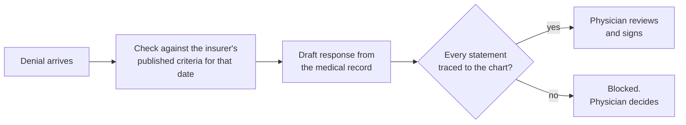

<picture>
  <source media="(prefers-color-scheme: dark)" srcset="assets/header-dark.svg">
  
</picture>

  
  
  
  

*James H. Rosing, MD, FACS · Board-certified surgeon, Newport Beach, California*

An insurer can now issue a claim denial in about a second. Answering it takes a physician hours. In between, a patient waits to learn whether the operation their surgeon recommended will be approved or refused.

This repository is the public record of one physician's attempt to change that balance: the evidence, the standard I think every medical AI should meet, and the work I am doing to meet it.

## The problem in three numbers

Medicare Advantage, 2023 ([KFF](https://www.kff.org/f63a430)):

| Requests denied | Denials appealed | Appeals overturned |
| :---: | :---: | :---: |
| **3.2 million** | **11.7%** | **81.7%** |

When denials are challenged, most fall. Most are never challenged, because the cost of answering lands on the people with the least time. Physicians report spending 13 hours a week on prior authorization, and 79% say patients have abandoned treatment while waiting ([AMA, 2025 survey](https://www.ama-assn.org/press-center/ama-press-releases/ama-survey-prior-authorization-reform-pledge-falls-short-physicians)).

I do not think most of the people who build these systems set out to harm patients. But a system rewarded for saying no, and rarely asked to show its reasons, will say no more often than it should.

<b>The public record on algorithmic denials</b> (5 cases)

 

| Who | Tool | What is alleged or reported | Status |
| --- | --- | --- | --- |
| UnitedHealth (naviHealth) | [nH Predict](https://distilinfo.com/2026/03/12/court-orders-unitedhealth-to-disclose-ai-denial-algorithm/) | Predicts post-acute length of stay for Medicare Advantage patients; plaintiffs allege about 9 in 10 denials were reversed on appeal | Class action in discovery, D. Minn.; March 2026 order compels records back to 2017 |
| UnitedHealthcare | [Post-acute review](https://www.healthcaredive.com/news/medicare-advantage-AI-denials-cvs-humana-unitedhealthcare-senate-report/730383/) | Post-acute denial rate rose from 8.7% (2019) to 22.7% (2022) | Senate investigation report, October 2024 |
| CVS Health | [Post-Acute Analytics](https://www.healthcaredive.com/news/medicare-advantage-AI-denials-cvs-humana-unitedhealthcare-senate-report/730383/) | AI project to reduce skilled nursing spending; savings target raised to $77.3M over 3 years | Senate investigation report, October 2024 |
| Cigna | [PxDx](https://www.healthcaredive.com/news/cigna-lawsuit-algorithm-claims-denials-california/) | 300,000+ claims denied in 2 months of 2022, averaging 1.2 s each | Class action, E.D. Cal., filed July 2023 |
| CMS | [WISeR](https://www.medicaleconomics.com/view/medicare-wiser-prior-authorizations-needed-congress-prior-authorization-lawmakers-say) | AI-supported prior authorization in traditional Medicare across 6 states, including skin substitutes, nerve stimulators, knee replacements, and cervical fusions | Live since January 2026; repeal resolution pending |

The insurers dispute these characterizations. UnitedHealth says nH Predict only guides care planning, and Cigna says PxDx is not AI.

## A standard, not a product

> **No machine should make a claim about a patient's care that it cannot support.**
> It must cite its source or show its derivation. If it cannot, it stops and the physician decides.

I wrote that standard down as **LITMUS** and published it openly under CC BY 4.0, so anyone can use it, test it, or argue with it. It applies to an insurer's algorithm as much as to mine.

- [Litmus: The Admissible Set](https://doi.org/10.5281/zenodo.21227402), position paper, July 2026
- [Litmus: The Admissible Set (System Architecture)](https://doi.org/10.5281/zenodo.21227855), architecture companion, July 2026

## What I am building

Software that answers a denial the way a careful physician would, with every statement held to the standard above.

If the record does not support an appeal, the software says so instead of arguing anyway. Nothing is sent without a physician's signature.

## This week: open models, measured in public

During the [Meta Global AI Developer Hackathon](https://cerebralvalley.ai/e/meta-ai-developer-hackathon) (Oct 26 to Nov 4, 2026), I am testing whether open-weight models can do the drafting while the verification step holds them to the same standard. If they can, an independent practice can run this without sending patient records to a vendor it does not control.

The test runs on 50 synthetic denials. No real patient data is used. Results, including failures, will be posted here.

| Model | Passed verification (%) | Ungrounded statements caught (count) | Latency (s per appeal) | Cost ($ per appeal) |
| --- | :---: | :---: | :---: | :---: |
| Current baseline | pending | pending | pending | pending |
| Muse Spark (Meta Model API) | pending | pending | pending | pending |
| Open-weight model, hosted | pending | pending | pending | pending |

## If you have seen this from the inside

Physicians, billers, patients, and people who work at payers: I want to hear what you have seen, where this approach is wrong, and what it misses. [Open an issue](https://github.com/jamesrosing/your-procedure-is-denied/issues) to start a conversation.

## Sources

- [Court orders UnitedHealth to disclose AI denial algorithm](https://distilinfo.com/2026/03/12/court-orders-unitedhealth-to-disclose-ai-denial-algorithm/), DistilINFO, March 2026
- [Senate report on Medicare Advantage AI denials at CVS, Humana, UnitedHealthcare](https://www.healthcaredive.com/news/medicare-advantage-AI-denials-cvs-humana-unitedhealthcare-senate-report/730383/), Healthcare Dive, October 2024
- [Senate PSI majority staff report on Medicare Advantage](https://www.hsgac.senate.gov/wp-content/uploads/2024.10.17-PSI-Majority-Staff-Report-on-Medicare-Advantage.pdf), October 17, 2024
- [Cigna sued over algorithm used to deny claims](https://www.healthcaredive.com/news/cigna-lawsuit-algorithm-claims-denials-california/), Healthcare Dive, July 2023
- [Medicare Advantage prior authorization, 2023 data](https://www.kff.org/f63a430), KFF
- [AMA survey: prior authorization reform pledge falls short](https://www.ama-assn.org/press-center/ama-press-releases/ama-survey-prior-authorization-reform-pledge-falls-short-physicians), AMA, May 2026
- [Lawmakers say WISeR prior authorizations needed Congress](https://www.medicaleconomics.com/view/medicare-wiser-prior-authorizations-needed-congress-prior-authorization-lawmakers-say), Medical Economics, May 2026
