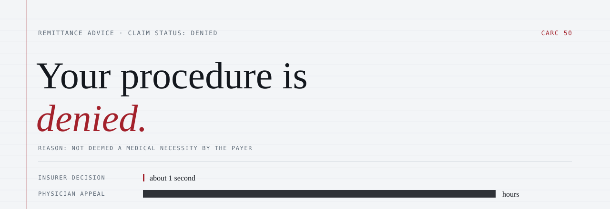
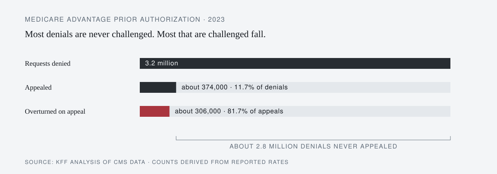
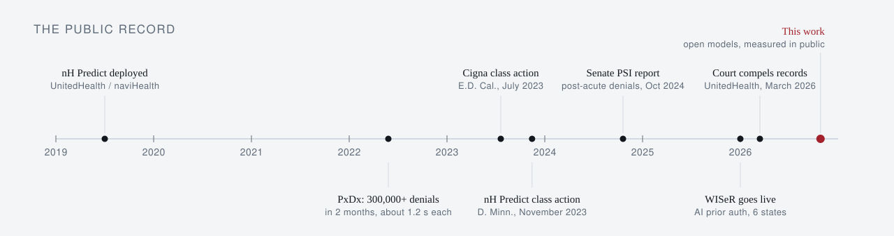
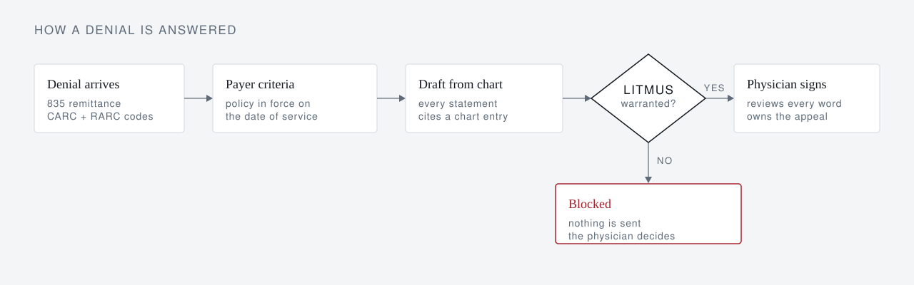

<picture>
  <source media="(prefers-color-scheme: dark)" srcset="assets/header-dark.svg">
  
</picture>

<p align="center">
  <a href="#the-problem">The problem</a> ·
  <a href="#the-public-record">The record</a> ·
  <a href="#a-standard-not-a-product">The standard</a> ·
  <a href="#what-i-am-building">The work</a> ·
  <a href="#measured-in-public">Results</a> ·
  <a href="#from-the-inside">Contribute</a>
</p>

<p align="center">
  <a href="https://doi.org/10.5281/zenodo.21227402"></a>
  <a href="https://doi.org/10.5281/zenodo.21227855"></a>
  
  
</p>

<br>

> An insurer can now issue a claim denial in about a second. Answering it takes a physician hours. In between, a patient waits to learn whether the operation their surgeon recommended will be approved or refused.
>
> — James H. Rosing, MD, FACS · Board-certified in general and plastic surgery · Newport Beach, California

This repository is the public record of one physician's attempt to change that balance: the evidence, the standard I believe every medical AI should meet, and the work of meeting it, measured in the open.

<br>

## The problem

| Requests denied | Denials appealed | Appeals overturned |
| :---: | :---: | :---: |
| **3.2 million** | **about 374,000** | **about 306,000** |
| 6.4% of 49.8 million requests | 11.7% of denials | 81.7% of appeals |

<sub>Medicare Advantage prior authorization, 2023.[^kff] Appealed and overturned counts are derived from the reported rates.</sub>

<picture>
  <source media="(prefers-color-scheme: dark)" srcset="assets/attrition-dark.svg">
  
</picture>

When denials are challenged, most fall. Most are never challenged, because the cost of answering lands on the people with the least time. Physicians report 13 hours a week spent on prior authorization, and 79% say patients have abandoned treatment while waiting.[^ama]

The surgeon whose judgment is overridden spent four years in medical school and five or more in residency and specialty training, and carries the license, the liability, and the duty to see the patient through. The decision to refuse carries none of that weight.

I do not think most of the people who build these systems set out to harm patients. But a system rewarded for saying no, and rarely asked to show its reasons, will say no more often than it should.

<br>

## The public record

<picture>
  <source media="(prefers-color-scheme: dark)" srcset="assets/timeline-dark.svg">
  
</picture>

<details>
<summary><b>Read the five cases</b></summary>
<br>

| Who | Tool | What is alleged or reported | Status |
| --- | --- | --- | --- |
| UnitedHealth (naviHealth) | nH Predict[^unh] | Predicts post-acute length of stay for Medicare Advantage patients; plaintiffs allege about 9 in 10 denials were reversed on appeal | Class action in discovery, D. Minn.; March 2026 order compels records back to 2017 |
| UnitedHealthcare | Post-acute review[^psi] | Post-acute denial rate rose from 8.7% (2019) to 22.7% (2022) | Senate investigation report, October 2024 |
| CVS Health | Post-Acute Analytics[^psi] | AI project to reduce skilled nursing spending; savings target raised to $77.3M over 3 years | Senate investigation report, October 2024 |
| Cigna | PxDx[^cigna] | 300,000+ claims denied in 2 months of 2022, averaging 1.2 s each | Class action, E.D. Cal., filed July 2023 |
| CMS | WISeR[^wiser] | AI-supported prior authorization in traditional Medicare across 6 states, including skin substitutes, nerve stimulators, knee replacements, and cervical fusions | Live since January 2026; repeal resolution pending |

The insurers dispute these characterizations. UnitedHealth says nH Predict only guides care planning, and Cigna says PxDx is not AI.

</details>

<br>

## A standard, not a product

<table><tr><td>
<br>
<p align="center"><b>No machine should make a claim about a patient's care that it cannot support.</b></p>
<p align="center">It must cite its source or show its derivation.<br>If it cannot, it stops, and the physician decides.</p>
<br>
</td></tr></table>

I wrote that standard down as **LITMUS** and published it openly under CC BY 4.0, so anyone can use it, test it, or argue with it. It applies to an insurer's algorithm as much as to mine.

#### [Litmus: The Admissible Set](https://doi.org/10.5281/zenodo.21227402)
<sub>Position paper · Rosing, J. H. · Zenodo, July 6, 2026 · doi:10.5281/zenodo.21227402</sub>

Generative artificial intelligence is entering clinical work ahead of any agreed method for making it safe. This paper argues that an autonomous system can be trusted only in proportion to the strength of the external check that verifies it, and that medicine has exactly one valid check: the certified specialist physician. That check has a definite shape. It returns membership in a small admissible set of treatments a qualified body would accept, a structure independently confirmed by a century of malpractice doctrine. Because the basis for membership is partly explicit and partly tacit, the machine may act alone only where consensus is explicit and settled, and must defer to the physician everywhere else. The paper sets out this method, litmus-gated reach, and the buildable system it implies.

#### [Litmus: The Admissible Set (System Architecture)](https://doi.org/10.5281/zenodo.21227855)
<sub>Architecture companion · Rosing, J. H. · Zenodo, July 6, 2026 · doi:10.5281/zenodo.21227855</sub>

This companion document specifies the system architecture implied by Litmus: The Admissible Set. The design is one substrate applied to many workflows: a model-pluggable agent runtime, an extensible registry of standardized tools, and a fail-closed verification spine whose criteria are curated per specialty. The machine acts alone where physician consensus is explicit, routes an evidence-bounded case to the certified specialist where it is not, and records every claim, gate decision, and verdict in a provenance layer. Feedback from physician verdicts, payer adjudication, and clinical outcomes widens what can be verified over time. The document details the layers, the runtime flow, an end-to-end medical coding and appeals workflow, the build sequence from existing components, and how the architecture scales across specialties and absorbs advances in model capability.

<details>
<summary>Cite</summary>

```bibtex
@misc{rosing2026litmus,
  author    = {Rosing, James H.},
  title     = {Litmus: The Admissible Set},
  year      = {2026},
  publisher = {Zenodo},
  doi       = {10.5281/zenodo.21227402}
}
@misc{rosing2026litmusarch,
  author    = {Rosing, James H.},
  title     = {Litmus: The Admissible Set (System Architecture)},
  year      = {2026},
  publisher = {Zenodo},
  doi       = {10.5281/zenodo.21227855}
}
```

</details>

<br>

## What I am building

Software that answers a denial the way a careful physician would, with every statement held to the standard above.

<picture>
  <source media="(prefers-color-scheme: dark)" srcset="assets/flow-dark.svg">
  
</picture>

If the record does not support an appeal, the software says so instead of arguing anyway. Nothing is sent without a physician's signature.

<br>

## Measured in public

During the Meta Global AI Developer Hackathon[^hack] (Oct 26 to Nov 4, 2026), I am testing whether open-weight models can do the drafting while the verification step holds them to the same standard. If they can, an independent practice can run this without sending patient records to a vendor it does not control.

The test runs on 50 synthetic denials. No real patient data is used. Results, including failures, will be posted here as they come in.

| Model | Passed verification (%) | Ungrounded statements caught (count) | Latency (s per appeal) | Cost ($ per appeal) |
| --- | :---: | :---: | :---: | :---: |
| Current baseline | pending | pending | pending | pending |
| Muse Spark (Meta Model API) | pending | pending | pending | pending |
| Open-weight model, hosted | pending | pending | pending | pending |

<br>

## From the inside

Physicians, billers, patients, and people who work at payers: I want to hear what you have seen, where this approach is wrong, and what it misses. [Open an issue](https://github.com/jamesrosing/your-procedure-is-denied/issues) to start the conversation.

<br>

---

<sub>Written by a practicing surgeon. Figures are drawn from public reporting and court records cited below; allegations in pending litigation are described as allegations. LITMUS papers © 2026 James H. Rosing, CC BY 4.0.</sub>

[^kff]: KFF analysis of CMS data on Medicare Advantage prior authorization, 2023. https://www.kff.org/f63a430
[^ama]: AMA, "AMA survey: Prior authorization reform pledge falls short with physicians," May 2026. https://www.ama-assn.org/press-center/ama-press-releases/ama-survey-prior-authorization-reform-pledge-falls-short-physicians
[^unh]: DistilINFO, "Court orders UnitedHealth to disclose AI denial algorithm," March 2026. https://distilinfo.com/2026/03/12/court-orders-unitedhealth-to-disclose-ai-denial-algorithm/
[^psi]: Healthcare Dive on the U.S. Senate Permanent Subcommittee on Investigations report, October 2024. https://www.healthcaredive.com/news/medicare-advantage-AI-denials-cvs-humana-unitedhealthcare-senate-report/730383/ Full report: https://www.hsgac.senate.gov/wp-content/uploads/2024.10.17-PSI-Majority-Staff-Report-on-Medicare-Advantage.pdf
[^cigna]: Healthcare Dive, Cigna lawsuit over PxDx claim denials, July 2023. https://www.healthcaredive.com/news/cigna-lawsuit-algorithm-claims-denials-california/
[^wiser]: Medical Economics, lawmakers on the WISeR model, May 2026. https://www.medicaleconomics.com/view/medicare-wiser-prior-authorizations-needed-congress-prior-authorization-lawmakers-say
[^hack]: Meta Global AI Developer Hackathon, hosted by Meta and Cerebral Valley. https://cerebralvalley.ai/e/meta-ai-developer-hackathon
